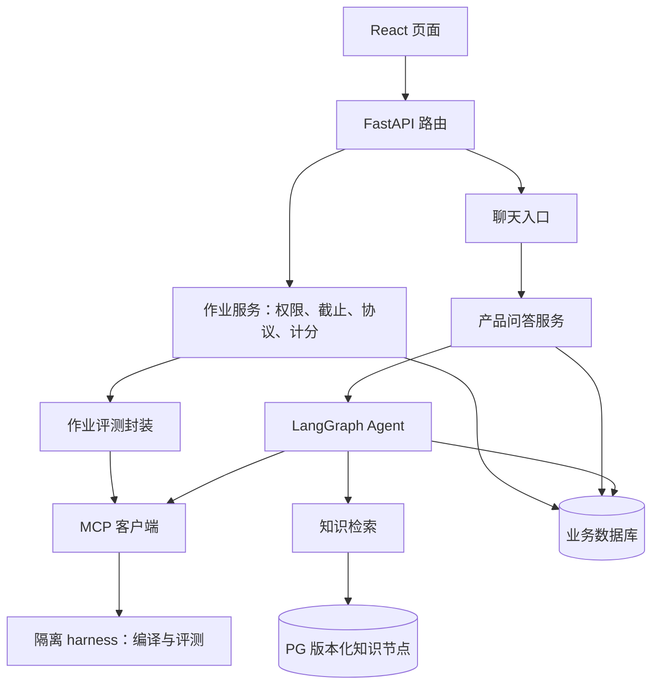

# 当前架构与证据

核查日期：2026-09-18。助手代码快照：`7048d8c793621ed53a3cacc51a717d81412884b5`；独立 harness 快照：`9ed5cfd7f03cd8b9c062a8d1a8d621403aaadcbc`。
本轮依据代码静态阅读及既有文档；没有运行浏览器、业务测试、真实模型或数据库验收。
S2 增量更新日期：2026-09-22；该批实现与本轮验证单列于路线 §11，不改变上述历史核查的证据范围。
S3 增量更新日期：2026-09-22；S3-a 决策冻结见 decisions.md §8，S3-b 实现与验证单列于路线 §12。
S4 增量更新日期：2026-09-23；S4-a/b/c/d 实现与验证分列于路线 §13——PG-only 收敛、产品路径唯一化、部署演练与试用走查为当前事实。
当前目标与实施顺序分别见[决策](decisions.md)和[路线](roadmap.md)。

## 1. 证据等级

| 标签 | 含义 |
| --- | --- |
| 代码确认 | 已阅读所列版本的实现，能说明结构或条件分支；不等同于运行验收 |
| 历史报告 | 引用既有报告中的测试、性能或故障结论，保留其版本和适用范围 |
| 本轮未验证 | 需要复现、实际环境或外部依赖确认，不据此宣布通过 |
| 目标行为 | 已确定的未来方向，尚未实现或未验收 |

## 2. 业务边界与调用关系（代码确认）

项目包含账号班级、作业管理、自由聊天助教、知识索引和独立代码评测。班级归属目前通过 `users.created_by` 表达，不是独立课程/选课模型。

- 作业发布不调用 LLM。正式提交校验作业可见性、截止时间、协议归属后直接评测；`assignment_id` 非空，按协议最高分折算。
- 聊天评测由模型调用工具，成绩的 `assignment_id` 为空，不计入作业成绩；两个入口共用评测日配额。
- 正式提交结果有「结果讲解」入口（S3-d）：`POST /api/assignments/{aid}/submissions/{sid}/explain` 以确定性 `explain-{sid}` 会话身份开讲解任务，不重评、不改成绩、重复调用幂等回放。总审查修复批次 4 起，讲解问题文本按成绩行 ID 稳定生成，旧讲解经 `purpose=explain` 核实身份后可在作业改名时接续。正式作业提交把受理时资格/协议分值存进结果元数据，本次响应按该快照计算；成绩汇总仍按当前作业项动态折算（decisions §8）。
- 代码依据：[作业路由](../backend/app/api/assignments.py)、[作业服务](../backend/app/services/assignment_service.py)、[Agent 工具](../backend/app/agent/tools.py)、[前端页面](../frontend/src/main.jsx)。

## 3. 聊天、检索与证据（代码确认）

S4-b 收敛后入口唯一：`/api/chat*` 恒由 `RagProductService` 产品任务路径执行（`RAG_PRODUCT_ENABLED`/`AGENT_ENABLED`/`RAG_ENGINE` 开关已随 legacy 引擎一并移除），编排装配失败 fail-closed 503。未读取本机或部署凭据文件，不推断实际运行配置。

产品路径自行组织图执行、候选答案和 judge，保存后才发送正文；普通 Agent 路径与旧问答编排已删除。

LlamaIndex 参与节点存储、模型适配和检索装配；混合召回、RRF、代码信号重排、MMR 仍由自有检索代码承担。LI 适配器复用 `RetrievalService`；旧 `ingestion_service` 中仍在服役的 reader/chunker 已收进 `services/knowledge_sources.py`（`rag_index_service`/`ingest_llama_index.py` 使用）。legacy 引擎文件（`ingest_repo.py`/`ingestion_service.py`/`PostgresRetrievalStore`）已删，`knowledge_chunks` 表保留供历史引用回读。

证据经过原始节点、工具正文截取、上下文摘要、产品 evidence 收窄和响应 citations 多种表示。检索成功不等于模型最终可见，也不等于引用对应。

S2 将首次可用 release 持久绑定到 `assistant_sessions.rag_release_id`，产品路径在检索前绑定会话。并发首次检索以数据库条件更新的赢家为准；后续请求及重建服务实例沿用同一版本，配置不符仍 fail-closed。没有活动 release 时不绑定、不读取无版本全库；新会话在首次检索时选活动版本。此为索引版本绑定，不是任务执行恢复。本轮验证范围见路线 §11。

**SSE 帧契约（`/api/chat/stream` 与 `/api/tasks/{task_id}/events` 同形，W13 成文）**：帧为 `event:`/`data:` 对、`\n\n` 分隔。事件类型：`start`（session_id/request_id/task_id）、`status`（阶段）、`tool_start`/`tool_end`（工具调用）、`sources`（**累计前缀帧**——每帧携带当前全量引用列表，前端逐帧整体替换，最终帧即完整集）、`delta`（正文增量）、`done`（终帧）。`done` 数据两种形态：正常终态 = ChatResponse 字段（answer_status/message_id 等）；任务终帧附加 `{status, terminal}`——`terminal:true` 为真终态（含 `status:cancelled`），`{status:"pending", terminal:false}` 表示任务仍在执行/暂不可重驱动，客户端应有界重试而非丢弃（S4-d）。取消任务的占位消息带 `answer_status=cancelled`，历史接口返回、会话记忆过滤（S4-d 口径分离）。

参考：[聊天路由](../backend/app/api/chat.py)、[Agent 服务](../backend/app/agent/service.py)、[图](../backend/app/agent/graph.py)、[产品服务](../backend/app/services/rag_product_service.py)、[LI 适配器](../backend/app/services/llama_index_service.py)。

## 4. 数据与恢复边界（代码确认）

| 数据/状态 | 当前存放方式 | 能力边界 |
| --- | --- | --- |
| 会话、正文、引用、摘要 | `assistant_sessions/messages/citations` | 能读历史，不等于恢复执行 |
| 作业与成绩 | `assignments/assignment_items/grading_submissions` | 成绩存 hash 与结果；正式提交没有业务幂等键。总审查修复批次 3 起聊天成绩带唯一 `task_job_id`，与 `rag_task_jobs.submission_done` 同事务写入；停号事务取消 pending 任务并撤销这些任务的聊天成绩 |
| 产品请求与问题闭环 | `rag_requests/issues/issue_events` + `rag_task_inputs`/`rag_task_jobs`（S3-c） | S2：`rag_requests.id` 为服务端 task_id，另存客户端 request_id/input_hash；完成请求按已解析 task 重放，未知历史 hash 拒绝重放；总审查修复批次 2：新任务的唯一键、临时输入、用户消息与日配额同事务受理，异常执行留下的 pending 保留输入供重驱动；不可恢复行仍由维护兜底判死 |
| 共享知识与修订 | `rag_knowledge/knowledge_revisions` | 发布记录与索引实际生效是不同步骤 |
| 索引快照 | `rag_releases/release_nodes/index_state` 与 LI 节点 | 原子发布、旧节点保留、校验后回滚 |
| 配额与实际用量 | `usage_counters` 与 `upstream_usage_records` | 次数和花费分开；unknown 不是零；硬崩溃下用量完整性未验证 |
| Agent 图、工具上下文、执行队列 | 进程内存，无 checkpointer；S3-c 起产品路径由 `task_service` 注册表托管（断线续跑/显式取消/终态回放 TTL 300s） | 图状态本身仍无 checkpointer——重启恢复靠「重驱动 + 账本复用」而非续跑断点 |
| 源码输入 | `rag_task_inputs` 表（S3-c）：受理时寄存原始问题+执行源，终态即清、24h `expires_at` 兜底、独立表便于备份排除；harness 临时目录 | 仅限产品任务存活期；对外接口不回读输入原文 |

产品路径的答案、引用与请求完成状态在同一事务中保存；这不把外部 harness 调用和数据库写入变成同一事务。响应丢失、重试与进程中断需要独立验证。

## 5. 外部依赖与测试边界

- **代码确认**：harness 是独立仓库，经 MCP streamable HTTP 调用；S3-c 起有 `job_id` 幂等语义与 `get_task_status` 只读查询（进程内存登记，重启清空属预期）。`mcp_server/server.py` 评测仍串行（全局锁在 job 协程内）；无 job_id 的旧路径同步阻塞事件循环未改。
- **代码确认**：harness 源码落临时目录后编译，finally 清理；生产容器只读根目录及 tmpfs 不承担跨容器重启的数据保管。部署隔离仍应保留。
- **代码确认**：主 CI 排除 live 和 postgres；前端现有测试在 API 客户端，不能替代页面验收。PG 专项和 live 工具已存在，但不能据此宣称本轮已执行。
- **历史报告**：检索题库、P0.1、P1、P2 的结果见归档及独立验收报告。版本、题库口径和环境不同，不能直接合并或倒算成果。
- **S4 已验证**：真实 compose 栈 account 模式端到端（S4-d 走查：登录/建作业/提交/成绩三态/讲解/取消/断线续跑/刷新找回，证据 `.logs/s4d_trial_closeout_20260923/`）；PG 迁移链与备份恢复（S4-c drill）；postgres mark 6/6（S4-c）；10 并发容量冒烟（S4-c）；**60 学生真实规模**（建号/登录/看作业 60/60、并发 10 问答 50 内联完成+10 得 409 等待超时如实终态、10 提交各落行，p50 80s 瓶颈在上游 LLM——`.logs/s4d_scale_multirep_20260923/`）；**backend 双副本**（观测到跨副本双执行后落地「属主心跳 updated_at + claim_recovery 认领闸」，复测：在跑任务不被抢、SIGKILL 后另一副本单份接管、跨副本 cancel 不被覆盖；残留：非属主看 status=pending、跨副本取消不停属主算力、admission 仍进程级 N 倍放大、>2 副本未测）。
- **本轮未验证**：live mark（需完整 ingest 的真实 embedding）、harness 重启中的在途作业、多学生班级隔离浏览器走查、CSV 导出端到端、>2 副本。

## 6. 首批核查问题清单

| 编号 | 问题与证据 | 本轮状态 | 后续归属 |
| --- | --- | --- | --- |
| C01 | 前端共六处字段错位：学生页读 `my_grades`（API 实际为顶层 `total_earned`/`total_points`/`items`），教师页读 `grades.items`、`row.class_owner`、`row.earned_by_protocol`、`row.total_points`（API 实际为 `assignment.items`、`class_teacher`、`scores`，行内无 `total_points`）；最重一处是教师成绩表协议列整列消失 | **已修（S1-a）**：六处取值改经 `grades.js` 纯函数 + 12 例契约测试；account 模式端到端走查逐格对照接口一致 | 已闭环 |
| C02 | Agent 工具片段编号与响应引用编号 | **S2 已实现**：按原始片段顺序构造引用，不按文件去重、不截四条，前端显示 `[n]`；验证记录见路线 §11 | 已闭环（S2 已验收） |
| C03 | SSE 已有文字时异常分支不补确定性评分 | **已修（S1-c）**：`grading_results` 非空无条件补 fallback delta；历史复现 F2，本批替身验证 | 已闭环 |
| C04 | 达上限可把未执行 tool_call 送入 finalize | **已修（S1-c）**：finalize 前补 `not_executed` 合成 ToolMessage；历史复现 F3，本批替身验证 | 已闭环 |
| C05 | 长源码参数压缩（**已修 S1-c**）；源码回显（B8）与同请求重复评测（B7）**已修 S3-b**：落库正文/标题/降级预览统一 redact 口径（含 `~~~` 围栏），同 (protocol, 执行源) 重复评测先去重、不二次扣配额不重复落成绩 | 历史报告 F1/F5/F6；S3-b 确定性测试覆盖 | 已闭环（S3-b 已验收） |
| C06 | 上传 hash 用原件，但工具执行输入来自模型参数 | **S3-b 已实现**：执行源带外三级解析（上传原件 > 服务端抽取围栏块 > 模型参数），`code_hash` 恒等于实际执行字节，`source_origin` 三值 upload/pasted/model_args | 已闭环（S3-b 已验收） |
| C07 | 后端无任务恢复；harness 无任务查询；断开连接和取消未分离 | **S3-c 已实现**（产品路径）：注册表托管执行（断线续跑）、`GET /api/tasks/*` 查询/续传/显式取消、孤儿重驱动+harness `job_id`/`get_task_status` 接续、`rag_task_inputs` 临时寄存；S4-b 起为唯一问答路径 | 已闭环（S3-c/S4-c 演练验收） |
| C08 | P0.1 完成声明与独立验收不一致 | 历史报告冲突，不宣布本轮已复验 | 可信基线 |
| C09 | 普通/产品路径生命周期、预算、用量、错误收口不同 | **S4-b 已收敛**：产品路径为唯一问答路径，普通 agent/legacy 管线删除，双轨差异项随路径删除消解 | 已闭环 |
| C10 | release 固定范围、幂等身份与原问题/附件对应、旧引用读取 | **S2 已实现**：会话持久锁 release；原始输入与附件字节 hash 参与身份，客户端 request_id 与服务端 task_id 分层；验证范围见路线 §11 | 已闭环（S2 已验收） |

## 7. 目标行为（S4 后剩余）

§1–§6 的目标行为项已随 S0–S4 全部交付：统一任务生命周期（task_service 注册表）、正式结果按需讲解（S3-d explain）、跨重启恢复（S3-c + S4-c 演练）、源码 24h 临时寄存（rag_task_inputs）、断线续跑（S3-c/S4-c/S4-d 实测）、judge 离线（S3-e，在线存留已定案维持离线——decisions §10）、PG-only（S4-b 收敛，生产无 SQLite 回退）。

剩余目标行为（下一阶段候选）：live mark 套件完整跑通（需真实 embedding 完成 ingest）、多学生班级隔离浏览器走查、CSV 导出端到端、harness 重启中的在途作业。60 学生规模与 backend 双副本已有实测证据（见 §5「S4 已验证」）；生产形态仍冻结为单副本（decisions §9），多副本防线属韧性改进而非扩容承诺。详细约束见当前决策，不以本文件描述代替实现与验收。
