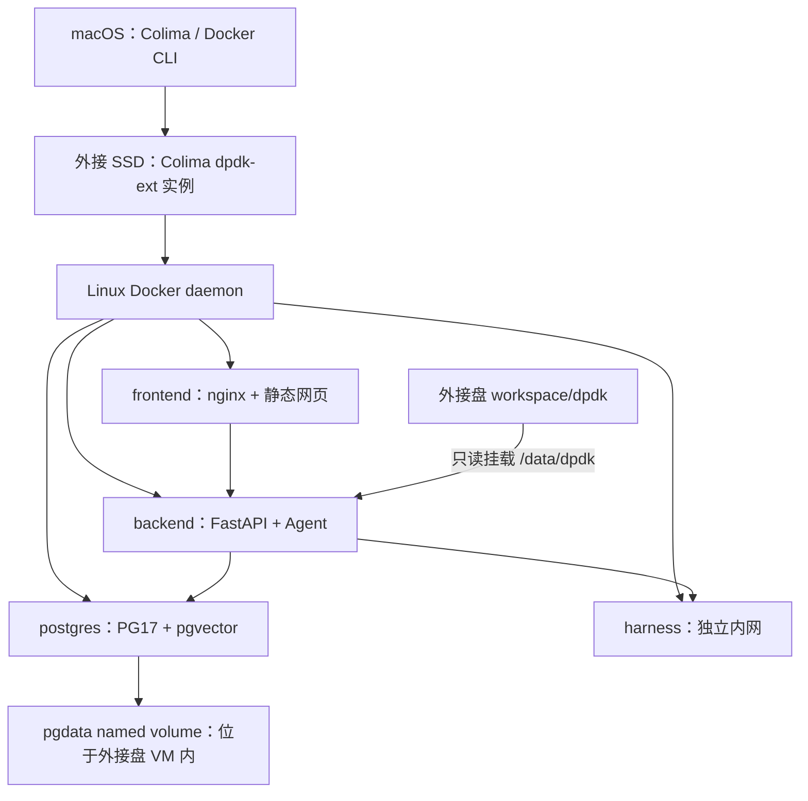

# 外接磁盘完整 Compose 部署迁移计划

日期：2026-10-10（Asia/Shanghai）。本轮交付：只读调查与方案文档。
用户已选择：迁移时一并改成完整 Docker Compose 部署。
本文是待执行方案；不代表迁移、部署、数据恢复或用户验收已经完成，不替代 `decisions.md` / `roadmap.md` 的阶段状态。

当日后续更新：用户已授权并实施 A「源数据与部署准备」，选定 `assistant_dev` 为新主库。下面的盘点保留初始调查时点，A 的最新备份、权限、工作副本与验证结果见 [A 批次记录](external_disk_batch_a_20261010.md)。新 VM、恢复演练、正式切换和清理尚未执行。

B 更新：用户随后要求保留原实例、镜像和旧代码，不再下载/构建。原 dpdk 已复制到外接盘，主库恢复并仅迁到原镜像支持的 0013，四服务运行与重启/备份恢复验证完成。原计划下面的新实例/全新构建/0015 目标已被本次选择替代；实际方式和限制以 [B 记录](external_disk_batch_b_20261010.md)、decisions §12、roadmap §16 为准。C/D 仍未授权。

C/D 更新：用户随后授权连续执行，已完成正式账号/入口切换与旧实体清理，保留原路径链接和独立恢复包。最新操作以 [C/D记录](external_disk_cutover_cleanup_20261010.md)、decisions §13、roadmap §17 为准；本文其余表格保留最初规划时点。

## 1. 结论与范围

采用「外接盘新建独立 Colima 实例 → 四服务 Compose → 分库逻辑备份恢复 → 验收后切换」方案。

- 外接盘承载 DPDK 主仓库、助手仓库、teaching_harness 仓库、Colima 配置/虚拟磁盘/下载缓存、Docker 镜像/构建缓存/日志、PostgreSQL 数据卷及日常备份。
- macOS 保留 Colima/Docker CLI 等小型程序及客户端配置，不搬整个 Homebrew；生产容器不依赖宿主机 Python `.venv`、Node 或 PostgreSQL 服务。
- 后端、前端、数据库、评测服务使用现有 `docker-compose.yml` 四服务架构。后端直接访问 `harness:8100`，不再依赖本地开发的 SSH 转发。
- 活跃 PostgreSQL 数据保留为 Docker named volume，位于外接盘上的 VM 数据磁盘内部；不把 PGDATA 直接绑定到 macOS 共享目录。
- 保留内置盘旧环境用于回退，清理另列批次。迁移验收前不会释放这部分空间。
- 不升级业务功能、模型、检索权重、FTS 策略或知识库内容；不 fetch/pull、commit/push，不自动 ingest，不执行真实模型评测。

Colima 0.10.3 官方文档支持通过 `COLIMA_HOME`、`COLIMA_CACHE_HOME` 指定存储位置。Docker volume 由 daemon 管理，所以数据库最终落在哪个物理盘取决于 daemon 所在 VM 的磁盘位置。[Colima 0.10.3 FAQ](https://github.com/abiosoft/colima/blob/v0.10.3/docs/FAQ.md)、[Docker volumes](https://docs.docker.com/engine/storage/volumes/)。

## 2. 本轮实测盘点

### 硬件、磁盘与代码

| 对象 | 本轮结果 | 含义 |
| --- | --- | --- |
| 主机 | MacBook Air，Apple M4，16 GB 内存 | ARM64 Linux 容器；外接盘不增加可用内存 |
| 内置盘 | 标称 251 GB，数据卷可用约 55 GiB | 暂保留旧环境和独立应急备份 |
| 外接 SSD | USB，设备名 HS-HUB-MDC1，标称 240.1 GB | 本轮未测持续写入速度、随机 I/O 或长期稳定性 |
| 外接卷 | APFS，`/Volumes/study`，可用约 223 GiB | 无需重新格式化 |
| 卷身份 | UUID `849D1FBD-CF92-4B50-9655-6D5E2F9C2A0B` | 启动必须同时检查 UUID 与挂载位置 |
| 卷权限 | Owners Disabled，未加密 | 迁移凭据/账号数据前启用属主管理并验证权限；加密选项单独由用户决定 |
| 助手仓库 | `/Users/fsy/code/dpdk/ai_chat_assistant`，约 1.5 GiB | 有本地未跟踪内容，不能只靠 git clone 重建 |
| DPDK 主仓库 | `/Users/fsy/code/dpdk`，约 1.9 GiB（包含助手） | 容器 `/data/dpdk` 的知识源必须一起保留 |
| harness 仓库 | `/Users/fsy/code/teaching_harness`，约 82 MiB | 独立仓库，不能遗漏 |
| 助手代码基线 | `main`，HEAD `a47a1bc9d23c0a8e625a79ff7cfbd096dcb3071c` | 本地跟踪信息显示落后 `legacy-gitee/main` 24 个提交；未联网刷新远端，不借迁移更新代码 |

助手现有未跟踪目录包括 `deploy/__pycache__/`、`docs/interview/`、`knowledge_work/zh_batch04/`、`zh_batch05/`、`zh_batch06/`。复制前要区分用户材料与可重建缓存；这些知识草稿随文件保留，不因迁移自动进入索引。

### 虚拟机与运行状态

| 对象 | 本轮结果 |
| --- | --- |
| Colima / Lima | 0.10.3 / 2.2.0 |
| 原实例 | `dpdk`，Stopped；ARM64、VZ、virtiofs、4 CPU、4 GiB 内存、30 GiB 数据盘容量 |
| 原 VM 所在位置 | `/Users/fsy/.colima`，实际占用约 7.9 GiB |
| 原磁盘拆分 | `_lima/colima-dpdk/disk`：逻辑 20 GiB、所在目录实际约 1.5 GiB；`_lima/_disks/colima-dpdk/datadisk`：逻辑 30 GiB、实际约 6.4 GiB |
| Docker 客户端 | 当前 context 为 `default`，没有可连接 daemon；当前 context 列表没有 `colima-dpdk` |
| 宿主机 PG | Homebrew PostgreSQL 17.10 正在运行，端口 5432，数据目录 `/opt/homebrew/var/postgresql@17`，约 314 MiB |
| 宿主机应用 | 本轮进程扫描未见助手 uvicorn/Vite 进程 |

不能把镜像、构建缓存和数据库大小再加到 7.9 GiB 上：它们已经包含在 VM 数据盘内。原实例停止且未启动，本轮没有验证其容器、volume、数据库或健康状态。

### 数据源必须分别处理

| 来源 | 本轮确认的数据 | 迁移处理 |
| --- | --- | --- |
| 宿主机 `assistant_dev` | 约 41 MB；27 条成绩、74 会话、148 消息、26 RAG 请求；账号/作业均 0 行；schema `0011_usage_records` | 完整备份；恢复后需迁移到当前代码的 alembic head；不能直接宣称账号教学闭环可用 |
| 该库活动索引 | release `ccbb92e558534cbcbd5e3d3b2ee4a30d`；声明/成员/物理节点均 3737 | 全量保留发布、节点、历史引用；不重嵌入 |
| 宿主机旧库 `assistant` | 约 154 MB；1477 会话、3057 消息、3583 物理节点；缺新版 RAG 发布、账号、成绩表 | 单独存档，不覆盖开发库或生产库，不直接合并历史记录 |
| 原 Colima 内 Compose 数据库 | 本轮未验证 | 执行批次先启动原 VM、明确旧 context/socket、只读核查并备份，再确定正式服务的数据源 |
| 其他宿主机库 | `assistant_rag_test`、`assistant_rag_probe_18334.tmp`、`postgres` | 不删除；测试库不迁入正式应用库 |

本地开发配置连接 `postgresql:///assistant_dev`；现有部署配置连接容器主机 `postgres:5432/assistant`。两者是不同数据库实例，即使库名相同也不是同一份数据。

**正式服务的数据源已由用户确定为宿主机 `assistant_dev`（A 批次）。** 原 Docker 库、开发库、宿主机旧库已各自产出带来源标签的备份和数据摘要；其余库保留独立归档，不跨库拼接业务表。

## 3. 目标目录和数据关系

固定如下目标目录。A 已建立工作副本、备份及占位目录；Colima 的 `_lima` 虚拟磁盘须在 B 经授权后创建：

```text
/Volumes/study/dpdk-runtime/
├── workspace/
│   ├── dpdk/                         # 完整主仓库及未提交材料
│   │   └── ai_chat_assistant/         # 镜像构建源、deploy/.env、证书
│   └── teaching_harness/             # 独立构建源
├── colima/                           # COLIMA_HOME
│   └── _lima/…                       # 系统盘及 Docker 数据盘
├── cache/colima/                     # COLIMA_CACHE_HOME
├── backups/                          # 日常逻辑备份，不包含临时源码
└── migration/                        # 数据清单、校验摘要、验收证据
```



新实例暂用 `dpdk-ext`、新 Compose 项目暂用 `dpdk-assistant-ext`，与原环境区分；实际 Docker context 名/socket 以新实例创建后实测为准。所有脚本显式指定实例、context、Compose 项目和 env 文件，拒绝依赖客户端当前默认 context。

建议初始资源：4 CPU、6 GiB 内存、60 GiB 数据盘容量，系统盘保持默认 20 GiB。这是配置建议，尚未验证全栈负载；正常运行后测启动/构建峰值、问答与 harness 并发，再调整。虚拟盘容量不是立即占用量，复制/归档磁盘文件必须保留稀疏属性。

规划先为运行、构建和备份留出 40–60 GiB 实际空间预算；这不是实测占用预测。后续如清理已迁移的旧 VM 和源码，当前内置盘对应占用约 10 GiB；不重复计算 `.venv`、node_modules 或 Docker 镜像，也不把仍保留的宿主机 PG 算入可释放空间。

## 4. 需要准备的配置和脚本

以下是部署约束；A 已准备对应入口和外接副本配置，原运行配置保留。容器运行、恢复与停机场景仍须 B 验证：

1. **启动入口**：校验 APFS 卷已挂载、UUID 匹配、可用空间和目标目录正确后，才设置 `COLIMA_HOME` / `COLIMA_CACHE_HOME` 并启动实例。拒绝自动 `mkdir /Volumes/study` 或默默回退内置盘。同时排除继承的错误 `LIMA_HOME` / `DOCKER_HOST` 对实例或 daemon 的干扰，实测磁盘和 socket 确实在外接盘。
2. **VM 文件共享**：显式将 `workspace` 挂入 Colima；只读共享即可满足 DPDK/证书 bind mount。光迁移目录、建符号链接或设置 `COLIMA_HOME`，不会自动让 VM 获得外接盘知识源。[Colima 外接盘挂载说明](https://github.com/abiosoft/colima/discussions/580)。
3. **Compose 路径**：`DPDK_REPO_HOST_PATH=/Volumes/study/dpdk-runtime/workspace/dpdk`；生产 `TEACHING_HARNESS_PATH=/Volumes/study/dpdk-runtime/workspace`，因为生产文件会追加 `/teaching_harness`。本地 compose 的同名变量是完整仓库路径，不可混用。
4. **命令一致性**：统一使用 `docker --context <实测外接实例context> compose --env-file deploy/.env -p dpdk-assistant-ext …`。`env_file` 是容器变量注入，不能代替 Compose 的 `--env-file` 插值来源。[Docker Compose 插值规则](https://docs.docker.com/compose/how-tos/environment-variables/variable-interpolation/)。
5. **容器配置**：数据库指向 `postgres`，harness 指向 `http://harness:8100/mcp`，DPDK 容器内路径保持 `/data/dpdk`。不沿用宿主机 Unix socket 或 `127.0.0.1:8100`。现有 `local_harness.sh` 固定旧 `.colima` 路径，只保留作旧开发环境回退入口。
6. **认证和入口**：保留 account 模式；若选用无账号的开发库，需用既有 CLI 建立首个管理账号。不自动更改或认领匿名历史会话归属。建议本机初次运行只绑定回环 80/443，待另行确定共享使用需求再放行局域网；现有 compose 的端口未限制回环。
7. **证书和凭据**：同机迁移保留 `.env`、证书和文件权限，避免进入 Git、镜像和日志。已有证书覆盖 localhost/127.0.0.1，有效至 2028-12-25；如果使用其他域名/IP，再配置相应证书。账号数据和凭据会随外接盘携带，启用属主管理，是否启用 APFS 加密由用户选择。
8. **备份入口**：现有 `deploy/backup.sh` 依赖默认 Docker context、默认 Compose 参数；需支持新实例和项目身份，外接盘缺失即失败。仍排除 `public.rag_task_inputs` 数据。日常备份在外接盘，另在内置盘保留至少一份净化的近期备份，应对外接盘损坏；同盘备份不能覆盖物理盘故障。
9. **停止入口**：先停止受理、等待/明确处理后台任务，再停止四服务和 Colima，确认磁盘无占用后才弹出外接盘。初期使用手工入口；自动启动要经过同样挂载检查，不能只在交互 shell 写 export 后就开启登录自启。
10. **可重建内容**：宿主机 `.venv`、node_modules、浏览器测试缓存不参与容器运行。优先按 Dockerfile/lockfile 构建镜像；旧环境原样保留到验收，不通过移动 `.venv` 实现部署。Python 官方说明虚拟环境不应视为可随意搬动的环境。[Python 3.11 venv](https://docs.python.org/3.11/library/venv.html)。

## 5. 数据库恢复路径

macOS Homebrew PG → Linux 容器 PG 使用逻辑备份，不直接复制 Homebrew PGDATA 文件。保留 PostgreSQL 17 大版本；实际目标镜像/扩展版本、ARM64 支持、digest 和下载可达性在构建批次核验。[PostgreSQL SQL dump](https://www.postgresql.org/docs/17/backup-dump.html)。

源开发库 pgvector 是 0.8.4；目标必须核对是否有可兼容的扩展版本，不能只看到 `pg17` tag 就放行恢复。镜像下载失败或扩展不兼容时停止该步骤，不降级丢向量。

恢复顺序：

1. 独立实例只启动 PostgreSQL；应用不受理请求、不能自动恢复旧 pending 任务。使用 PG17 `pg_dump -Fc`，每个数据源独立归档；备份排除临时执行输入数据，保留其结构。源库无该表时记录版本差异。
2. 先在隔离库还原并验证。目标恢复库必须真正为空，使用 template0；现有 PG 镜像 initdb 会先创建 zhparser/zh 配置，不能不检查内容就把该库当空库恢复。需避免扩展/配置重复冲突。
3. 按明确的目标所有者恢复（例如映射到 postgres，使用 `--no-owner --no-acl`）；应用 users 表账号与数据库角色是不同概念。不能照搬 Homebrew 本地角色/认证规则而忽略容器认证。
4. 使用 `pg_restore --exit-on-error`，必要时整事务恢复；任何错误都保留日志、停止验收，不以“多数表恢复了”放行。[pg_restore](https://www.postgresql.org/docs/17/app-pgrestore.html)。
5. 对还原副本执行 `init_db()` → `alembic upgrade head`；不要 `stamp head` 跳过真实迁移。源库若已完整到 head，验证幂等；若来自开发库，则明确记录 0011 → 当前 head 的升级结果。迁移失败可丢弃新副本重做，旧库保留。
6. 核对源/目标表计数、关键业务记录及关系、会话与引用、发布 ID、声明/成员/物理节点数量；不输出问题全文、源码、密码或 token。源端无临时输入的归档，不应把 pending 任务当可恢复任务：最终备份前停新受理、让在跑任务终态；若仍有未决任务，按现有取消/恢复规则明确处理后再切换。
7. 保持 embedding 模型、endpoint、1024 维和 chunker 指纹一致。本轮已核实开发库活动 release 与 backend/deploy 配置中的模型及 endpoint 相符；路径变化不在当前指纹内，节点来源使用相对路径。因此搬盘本身无需重新 ingest，但容器就绪/真实检索仍待验收。
8. 隔离库验证后，在受控停写窗口从选定源做最终备份恢复，恢复完成再启动应用。不要在应用自动迁移/任务恢复后往其中恢复覆盖。

## 6. 建议的执行批次

每批由用户单独授权；A 已授权并实施，B/C/D 尚未授权，不自动启动。

| 批次 | 目标与产物 | 放行依据 | 回退 |
| --- | --- | --- | --- |
| A：源数据与部署准备 | 明确各库来源；启动旧 VM 做只读盘点，分别备份；确认正式数据源；复制工作材料；准备启动/停止/备份入口与 Compose 配置 | 来源清单、备份目录清单/校验值、磁盘权限与 UUID 检查；未切换业务 | 原路径、原库和原 VM 保留；移除新配置即可 |
| B：外接盘隔离演练 | 新建外接 Colima 实例；构建四镜像；新 PG 副本还原升级；启动隔离全栈 | 数据对照、节点/版本指纹、就绪、权限、SSE 恢复、harness 隔离、重启持久性和备份恢复证据 | 停新栈；旧环境仍为数据权威 |
| C：正式切换 | 停写、处理在跑任务、最终备份还原；切入口；停旧服务自启；更新操作文档与路线记录 | 最终数据对照和用户验收；明确新环境成为唯一写入端 | 未放行新写入前可直接回旧环境；已写入后须先备份新数据并制定回迁，禁止启动旧库制造双写 |
| D：旧环境清理 | 验收且回退保留期结束后，清理指定旧 VM、冗余依赖/缓存；保留独立备份 | 用户单独授权删除清单，确认不含其他数据库/项目 | 删除前备份；不把旧环境删除当自动步骤 |

批次 B 的真实模型/embedding 问答会产生费用，应另行限定小规模测试预算；网络、容器、DB/检索只读校验和模拟测试先完成。未知费用按既有项目规则停下记录，不自动扩大评测或重建索引。

## 7. 验收与失败条件

- **存储位置**：新 Colima 配置/两类虚拟磁盘/缓存路径均位于预期外接卷；Docker root/PG volume 在该 VM 内，实际空间增量与方案一致。
- **磁盘缺失**：无磁盘、错误 UUID、同名卷挂到 `study 1`、空间不足时，启动入口明确失败；不生成第二套空库或内置盘 VM。通过安全的条件注入验证拒绝路径，不在运行中拔盘做故障测试。
- **数据库**：恢复无错误；schema 到当前 head；账号、成绩、作业、会话、引用、请求和向量数据与选定源一致（迁移产生的差异单列）；临时源码不进归档。
- **索引**：活动发布可读、物理节点完整、指纹一致、历史引用有效；`/api/ready` 通过只是基础条件，另验证实际检索结果。
- **产品链路**：account 登录、已有会话、至少一个受控问答与 SSE 重连、必要的作业/评测链路；历史质量结论不视为本轮结果。真实模型调用须在预算授权后进行。
- **隔离**：只开放确定的网页入口；PG/backend/harness 无宿主机发布端口；harness 仍仅挂 internal 网络、非 root、read_only、tmpfs、资源限制。主项目知识源只读。
- **重启与持久性**：四服务和新 Colima 正常停止/启动后，数据、发布 ID、会话引用仍在；启动过程中不会误驱动已经失去执行输入的任务。
- **备份恢复**：新备份入口对准新实例和项目；在一次性隔离库实际还原验证，不以 `pg_restore -l` 或备份文件存在代替恢复成功。
- **资源**：记录启动、构建、运行时峰值；确认 6 GiB VM 配置可承载本轮约定负载。USB 链路性能本轮未验证，部署后测实际恢复/读写时间再判断。

记录分别列为「配置实现」「自动检查」「场景验收」「用户验收」。未完成项明确标记未验证，不能把搬文件、容器 Up、HTTP 200 或历史测试结果写成已交付。

## 8. 尚待确定的事项与本轮边界

1. 正式数据源：用户已确定为宿主机开发库 `assistant_dev`；其他两库各自归档。
2. 访问范围：本机回环为本方案初次演练默认；如果要供同学访问，另定局域网入口、证书与账号准备。
3. 外接盘加密、自启动、旧环境回退保留期：尚未决定，不自动配置或删除。
4. 网络构建成功、目标扩展兼容、真实模型链路、USB 长期稳定性：本轮未验证。

初始调研只读取磁盘/进程/仓库/非敏感配置，执行 PG catalog/行数查询和公开官方资料检索，当时没有启动/停止服务、创建 VM、改配置、导出数据库或复制部署数据。之后获授权的 A 操作及状态另记于 [A 批次记录](external_disk_batch_a_20261010.md)；没有调用模型或提交推送。
