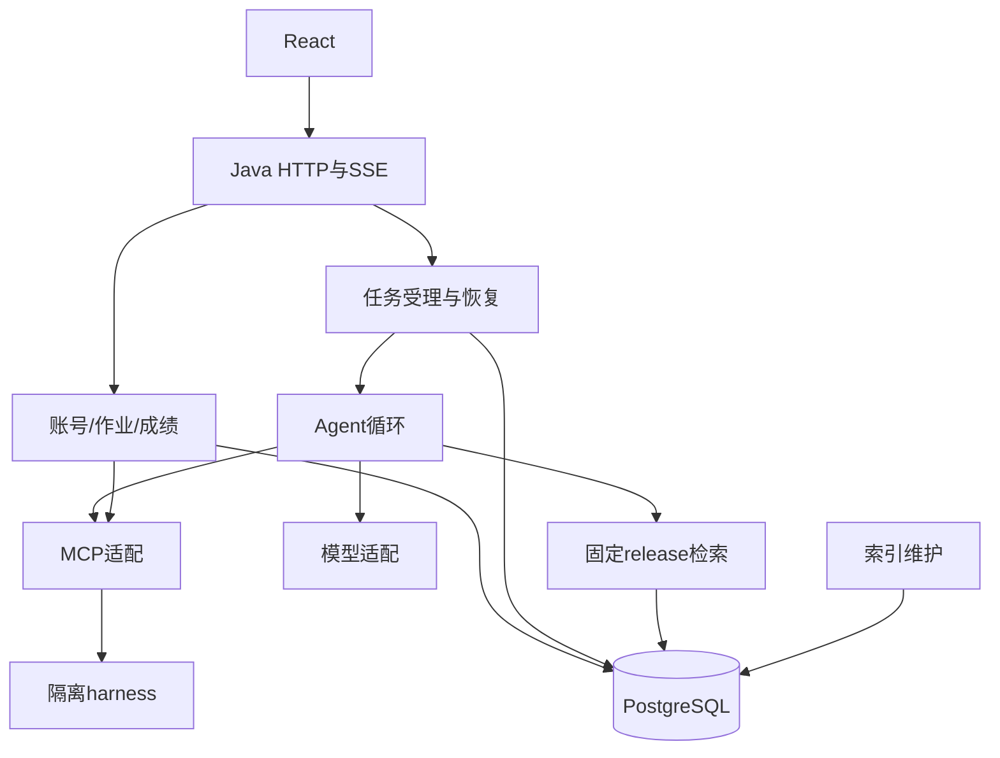

# 目标架构与接口约束

状态：P0契约收口中；Java代码尚未建立，P1仍未获授权。已选择Java21 / Spring Boot4.0.9 / Spring AI2.0.2及Spring JDBC / Flyway，依据见DECISIONS/P0-D14；实际构建与协议适配待P1验证。可消费接口语义见 `../../migration/contracts/transaction-ports.json`，不得把拟议签名当已实现类。

## 模块结构

`backend-java/src/main/java/io/dpdk/assistant/<feature>/` 与同形test包。包内按需要划分api/application/domain/persistence；避免每个简单对象都增加一层。对外接口隐藏业务不变量，调用者不直接拼接其他模块的SQL。

| 模块 | 对外职责与接口语义 | 负责切片 |
|---|---|---|
| platform/contracts | 配置校验、事务参与机制、时钟、错误映射、共享DTO、健康/观测基础 | J0-01/J1-01，集成者 |
| model | 对话、工具调用消息、embedding、usage与失败分类 | J1-02 |
| harness | MCP初始化/调用/查询、submitted状态、job_id和结构化结果 | J1-02 |
| retrieval | 在固定release和配置指纹上返回有序证据；保留候选与重排trace | J1-03 |
| auth/admin | 认证主体、角色树、账号生命周期、审计 | J2-01/J2-02 |
| assignment | 发布、成绩聚合、正式评测和讲解入口 | J2-03/J2-04/J3-04 |
| session/usage | 会话身份和release绑定、历史引用、配额/实际用量的事务参与接口 | J2-05 |
| task | 原子受理、登记/订阅/取消/恢复；调度与HTTP连接解耦 | J3-01 |
| agent | planner/tools/finalize循环与请求级工具上下文 | J3-02 |
| chat | HTTP/SSE适配、证据判断、答案/引用/终态收口 | J1-04后顺序交给J3-03 |
| index | 快照、切块、嵌入、发布CAS、回滚与就绪校验 | J4-01 |
| knowledge | 问题反馈/认领/合并/原题验证/共享知识修订 | J4-02 |

先定义确实发生变化的接口：模型、harness、检索与时钟是替身/真实实现的接缝。不要为每一个内部类制造公共接口。公共契约版本只由集成者更新；任务owner提交需求和兼容影响。

## 编排路径

## 数据策略

初期保留现有业务表与LI物理节点表，SQL适配 `node_id/text/metadata_/embedding/text_search_tsv` 及 `rag_release_nodes`。Spring AI默认VectorStore建表不能替代现有版本模型；禁用未经审核的自动建表/DDL更新。

P0生成schema inventory：每张表的来源revision、主键/唯一约束/索引、旧版兼容、所有者及字段序列化。Java实现保留现有ID、bcrypt与token摘要格式；旧的NULL hash保持拒绝重放规则。

新库采用单一Flyway链设计（B0015全量、V0014/V0015增量）；三路径实际执行留J1-01。既有库只有在核对实际表/约束和migration版本后才能登记baseline。保留alembic历史作为对照，不机械把SQL复制后stamp，不让两套迁移器同时拥有DDL。迁移唯一owner为主Agent（后续J1-01集成窗口）。

完整路径与失败前置见 `../../migration/contracts/schema-migration.md`。J1-01实现测试库流程，J5-03才处理授权的接管演练。所有schema脚本由集成者串行集成；任何自动迁移前先执行数据库身份预检。

## 必须冻结的跨模块契约

| 契约 | 必须包含的内容 |
|---|---|
| RequestIdentity | NFC/strip规则、JSON字节编码、附件名/原字节hash、request_id/task_id/session_id范围 |
| TransactionParticipation | begin/finish/cancel事务所有者；session/usage仓储参加已有事务，不私自提交 |
| TaskExecution | HTTP订阅与执行解耦；原子登记；单任务收口；取消与完成竞态；恢复认领和心跳 |
| ToolExecutionContext | 原始请求/上传源带外注入、来源身份、配额/账本、取消状态；工具结果是数据 |
| ModelResult | 文本/tool_calls/usage/失败类型；unknown用量不伪装0；重试可否安全 |
| Evidence | node_id/release_id/内容与顺序/引用编号；工具摘要不丢失证据对应关系 |
| StreamEvent | 原有事件及终帧；sources累计前缀；pending terminal=false；未知事件客户端兼容 |
| HarnessResult | structuredContent和文本JSON、isError、job状态、已提交失败的未知结果 |
| ReleaseConfiguration | 配置字段及原序列化字符串兼容；embedding维度和模型一致性 |

这些是P0应交付的明确接口文档与fixture，不是本轮已经定义完成的Java方法签名。

## 并发与事务

- asyncio单线程内“无await即不交错”的逻辑要转为Java显式同步/原子状态转换；ConcurrentHashMap只保证单次操作，不保证多步协议。
- 任务状态落库为真，进程内句柄用于执行和订阅；状态和HTTP结果须区分pending/running/terminal。恢复是重驱动与账本复用，不宣称任意图节点续跑。
- 原子受理涵盖请求唯一键、临时输入、用户消息和配额；答案/引用/终态同事务。外部LLM/MCP调用在事务外。
- 限额、DB池、上游并发闸与订阅资源各自有上限；虚拟线程不能替代admission。若使用虚拟线程需单独验证关闭/取消语义。
- SSE通过Spring MVC支持的方式发送，任务由独立执行器管理；连接断开只移除订阅。采用其他HTTP实现时仍满足同一契约。
- 单副本为验收主形态；已有心跳/认领防线作为兼容韧性保留，多副本扩容不在本轮承诺内。

## 外部依赖

DPDK知识源和teaching_harness分别固定路径/版本/许可。先用合成小语料和MCP替身验收；真实源挂载只读。真实评测保留独立容器、无外网、非root、只读根、tmpfs与资源限制。

前端保持React；根 `frontend/src/api/client.js`/`main.jsx`/部署入口由集成者串行改。新旧实现路由切换按环境整体选择，首批不建立跨语言双写和复杂混合生产路由。
