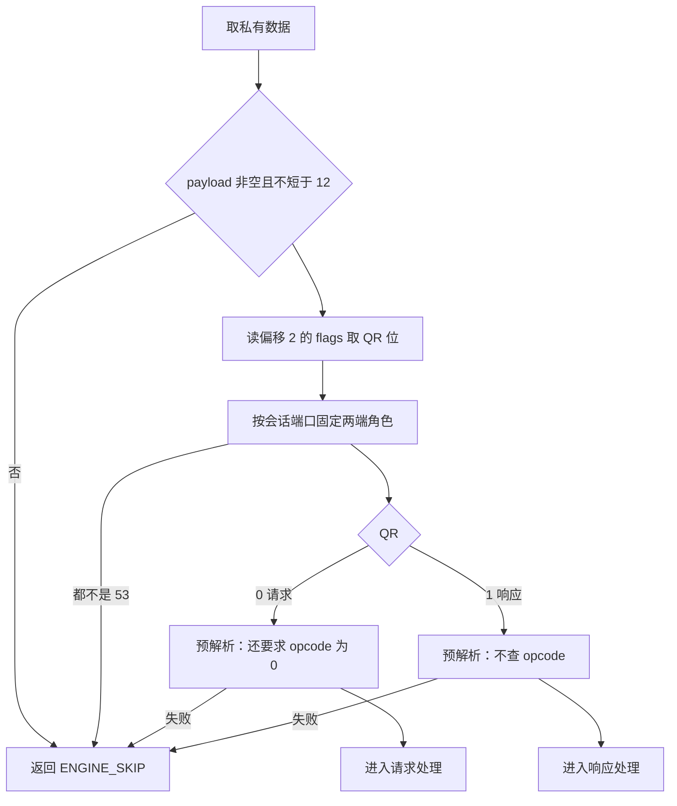

# DNS 判据与解析：从 UDP 53 到域名还原

`engine_dns.cpp` 常被当作“完整协议插件”的参考，读它时最容易把 DNS 通识当成项目能力。本篇只讲两件事：报文要满足什么条件才会进入这个插件，以及进入之后按什么规则解析、在哪些条件下失败。结果落在哪里、失败怎么返回，见姊妹篇。

## 适用版本与阅读目标

面向懂 C 和网络基础、初识本项目的学生，依据 DPDK 仓库 `20f882691ac03998e0e148e0a66041227cd3f751`（分支 master），状态：**待人工审核**。结论全部来自静态回读；未编译插件、未加载、未构造报文验证，因此**没有**任何报文解析结果。逐条依据见[事实表](../evidence/dns_detection_and_parsing.md)。范围到 `dns_parse_name` 为止；姊妹篇：[DNS 结果与返回值](dns_results_and_returns.md)。

## 核心对象和术语

一个容易找错位置的定义：会话侧那条记录的结构 `dns_ext_data_t` 真实定义在 `session/session.h`，`plugin/plugins/dns_ext.h` 只是向后兼容的转发头。插件自己的私有数据 `dns_engine_data_t` 挂在 `ctx->private_data` 上，内含一张按客户端地址分层的域名缓存和一把互斥锁。三个术语别混用：“识别”指 `can_handle` 为真，“解析成功”指预解析函数返回真，“已计入”指会话扩展上的 `counted` 置位。

来源：`plugin/plugins/dns_ext.h`、`session/session.h`、`plugin/plugins/engine_dns.cpp`；事实 DN-001。

## 插件接入与调度位置

插件在文件末尾准备一张静态操作表：`name` 为 `DNS`、`protocol_id` 为 53、`priority` 为 120，四个核心回调齐备而 `get_stats`/`reset_stats` 为空，再由 `extern "C"` 的 `engine_get_ops` 导出。装载方是 `main.c` 的固定列表，按文件存在性判断后交给 `engine_registry_load_plugin` 走 `dlopen`；构建规则把 `engine_dns.cpp`、`domain_intel.c` 与事件对象用 `g++ -std=c++17 -fPIC` 链成 `engine_dns.so`。

进插件前还有两道与插件本身无关的门：`main.c` 两条路径都要求会话与注册中心非空才调 `engine_process`；调度器在链上**先**给条目的 `packets_processed` 加一，**再**判断 `can_handle`。所以“计数涨了”不代表 DNS 代码跑过。

来源：`plugin/plugins/engine_dns.cpp`、`main.c`、`plugin/plugins/Makefile`；事实 DN-002、DN-003、DN-004。

## can_handle：本版本只认 UDP 53

判据是一行合取：协议字段等于 17，且源端口或目的端口之一等于 53；它不读 `payload`、不读会话、不检查负载长度。

由此可直接界定能力边界：本版本**没有 TCP 路径**——端口 53 上的 TCP 报文、以及其他端口（例如 853、5353）上的 DNS 负载都不会进入这个插件。上报结构里 `transport_proto` 的注释允许 TCP 与 UDP 两种取值，但写入处是常量 UDP，所以那个字段不能用来区分承载方式。

“加密 DNS 由 TLS 类插件负责”这句既有文档说法在代码里确有落点：`session/session.h` 为 TLS Infra 定义了带 `is_doh`/`is_dot`/`is_ech` 标志的扩展结构，`engine_tls_infra.cpp` 按 `hit_dot` 置 `is_dot` 并同样经 `session_set_ext_data` 占用会话槽位。但该插件的判据与检测完整性本批未核验，不能据此宣布加密 DNS 已被覆盖。

来源：`dns_plugin_can_handle`、`plugin/plugins/ch_event.h`、`plugin/plugins/engine_tls_infra.cpp`；事实 DN-005、DN-006、DN-007。

## process 的解析流程

`process` 先过四道门卫：私有数据、会话、报文与 `payload` 都非空，且 `payload_len` 不小于 12，任一不满足返回 `ENGINE_SKIP`；随后从负载偏移 2 读两字节 flags，用最高位区分请求与响应。

两端角色**不是**从当前报文方向推的，而是由会话保存的端口固定：会话目的端口是 53 而源端口不是，源端算客户端；反之则目的端算；两端都是 53 时按“源端是客户端”处理；两端都不是 53 时格式化失败并返回 `ENGINE_SKIP`。也就是说角色取决于**哪个报文先建了会话**，与会话篇的 SL-003 同源。

预解析时问题区名从固定偏移 12 开始，名字走完还要求剩余至少 4 字节放类型与类；请求分支额外要求操作码字段为 0（所以非查询类报文进不了请求路径），响应分支不查操作码。两步预解析都在取或建会话扩展**之前**完成，失败时不会留下空域名记录。

来源：`dns_plugin_process`、`dns_format_session_roles`、`dns_parse_request_info`、`dns_parse_response_info`；事实 DN-008、DN-009、DN-010。

## 域名还原与长度、指针边界

还原函数按“0 结束、高位为 1 是指针、其余是普通标签”三分支处理。递归深度超过 10 判失败；指针分支要求后一字节在界内、目标偏移小于包长，跟随后加二并**跳出**当前循环，链式压缩靠递归展开——深度上限是该函数里唯一的环路保护。

普通标签要求长度不超过 63 且不越界；字符只放行字母、数字和连字符，以 `xn--` 开头的标签放宽到可打印 ASCII。整体还有三道检查：包内偏移不得越界、名字长度不超过 253、名字必须至少含一个点或是单点根域；含不可打印字符判失败，非 UTF-8 返回另一个错误码。最后一道对教学很关键：**只有单个标签的主机名会被判失败**，而不是被接受为简化形式。

来源：`dns_parse_name`；事实 DN-011、DN-012。

## 边界、异常与常见误解

三条容易越界的读法：把 `can_handle` 读成“按负载特征识别 DNS”（它只看协议号与端口，DN-005）；把“压缩指针被支持”读成“有完善的环路防护”（唯一防护是深度 10，DN-011）；把 DNS 通识里的单标签主机名、任意端口、TCP 承载当作项目能力（DN-006、DN-012 都判失败或不进入）。

本批未验证：任何报文解析结果、深度与长度阈值在真实流量下的命中率、`engine_tls_infra` 的加密 DNS 判据。这些不能从本篇流程图推出。

来源：事实 DN-005、DN-006、DN-011、DN-012。

## 阅读顺序与自查问题

建议顺序：文件末尾的静态操作表 → `dns_plugin_can_handle` → `dns_plugin_process` 的门卫段 → 两个预解析函数 → `dns_parse_name`。

判断某类 DNS 报文为什么未被识别，按这个顺序排除（事实 DN-013）：`main.c` 有没有给出非空会话 → `parse_packet` 是否把协议填成 17、端口填成 53（短包会让端口保持 0，见首批 PF-005）→ `can_handle` 的端口判据 → 负载长度与 QR、操作码组合 → 问题区还原是否因没有点、含非法字符或深度超 10 而失败。每一步都对应上面某个返回路径；确认报文被接住之后，再看[结果与返回值](dns_results_and_returns.md)。

自查：为什么 853 上没有事件？为什么某条查询有会话但没有域名记录？这些是读码练习，不构成独立验收。

来源：事实 DN-013。
