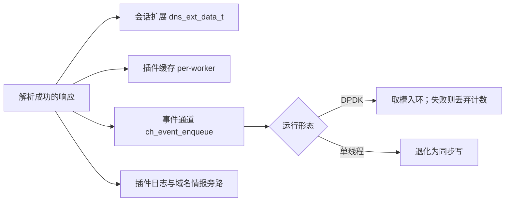

# DNS 结果与返回值：结果落在哪里、失败怎么返回

同一个 DNS 响应可能留下会话扩展、留下插件缓存、也可能什么都没留下。本篇按“解析出来之后”的顺序讲：哪些资源记录真被解码、结果进哪几个通道、各种情况返回什么。判据与解析规则见姊妹篇。

## 适用版本与阅读目标

面向懂 C 和网络基础、初识本项目的学生，依据 DPDK 仓库 `20f882691ac03998e0e148e0a66041227cd3f751`（分支 master），状态：**待人工审核**。结论全部来自静态回读；未编译插件、未加载、未构造报文验证。逐条依据见[事实表](../evidence/dns_results_and_returns.md)。姊妹篇：[DNS 判据与解析](dns_detection_and_parsing.md)。

## 核心对象和术语

先分清三态：识别、解析成功、已计入（见 DN 篇的 DN-001）。本插件的私有数据挂在引擎条目上下文里，而 DPDK 流水线为每个 worker 单独创建注册中心、各自加载同一个 `.so`，所以那份域名缓存是**每 worker 一份**，不是全局视图；会话扩展 `dns_ext_data_t` 则跟着会话走，寿命与回收由会话模块决定（见 SF-007）。

来源：`plugin/plugins/engine_dns.cpp`、`main.c`、`plugin/engine.h`；事实 DR-001。

## 答案区遍历与解码范围

答案区从问题区之后（还原返回的偏移再加 4）开始，按头部 `ancount` 次循环：每轮先要求剩余至少 10 字节，再要求 `rdlen` 不越界，任一不满足就**跳出**循环。真正解码出内容的类型只有四种——A（且 `rdlen` 为 4）、AAAA（且 `rdlen` 为 16）、CNAME 与 NS；其他类型只把类型号与 TTL 放进列表，不产生值、也不写进会话扩展。授权区与附加区没有被单独遍历，EDNS0 选项不做解码。

因为失败是跳出而非报错，`ancount` 与实得条数可以不相等：第 3 条记录越界，后面全部不处理，而前 2 条已经写进结果。

来源：`handle_dns_response`；事实 DR-002。

## 结果保存在哪里

会话扩展：先按槽内对象的魔数决定复用还是新建，新建走 `session_set_ext_data`——按 SF-007，这一步会释放该会话上原属其他插件的对象。答案最多写 `DNS_MAX_ANSWERS`（8）条，超出静默丢弃；每次处理响应前 `answer_count` 被清零，所以扩展里只保留**最后一次**响应的摘要。

插件缓存受三个上限约束：条目最后更新超过 `CACHE_TIMEOUT`（30 秒）即清、全局不超过两万条、单客户端不超过 512 条；清理在处理函数首尾各调一次，平常每 5 秒才真正扫一遍，除非已超硬上限。

事件通道**仅在 rcode 为 0 时**组装并交给 `ch_event_enqueue`：DPDK 下从内存池取槽入事件环，取不到或环满就归还槽、累加丢弃计数后返回；单线程下环未初始化，退化为同步写。所以“插件返回成功”不等于记录已经存在。rcode 非 0 时在发事件之前提前返回，但会话扩展此前已被这条失败响应覆盖。另有两条旁路：置“已计入”之前写一条插件日志决策事件；请求分支把域名交给 `domain_intel` 做威胁与重点关注域名匹配。

来源：`dns_get_or_create_ext`、`dns_cache_cleanup`、`handle_dns_response`、`plugin/plugins/ch_event.c`；事实 DR-003、DR-004、DR-005、DR-006。

## 返回值：跳过、失败与成功

这份实现**从不返回** `ENGINE_HANDLED` 或 `ENGINE_ERROR`：所有门卫与预解析失败都返回 `ENGINE_SKIP`，走到末尾的成功路径自增 `ctx` 的 `packets_matched` 后返回 `ENGINE_CONTINUE`。注册中心只对 HANDLED 与 ERROR 有分支，SKIP 与 CONTINUE 同样落入“继续下一个引擎”，二者可观察差别只在插件自己那份匹配计数——被 SKIP 的包不加 `packets_matched`，但**仍然**已经加过 `packets_processed`。这两个计数之比就是该插件的格式接受率。

去重实际只依赖 `ext->counted`：一旦置位，同一会话上的后续响应会在更新缓存与发事件**之前**整体返回；该标志在登记另一个待处理请求时清零。若会话扩展为空（例如分配失败），这条去重被跳过，每个响应都照常处理；rcode 非 0 的响应不置该标志。文件里定义的 `dns_ext_same_pending_request` 在当前阶段没有被响应路径调用，源码注释把它写成有意暂不启用。

来源：`dns_plugin_process` 的返回式、`dns_ext_mark_pending_request`、`plugin/engine_registry.c`；事实 DR-007、DR-008。

## 共享状态与实现缺口

`init` 用 `new` 分配私有数据后紧跟一个空指针判断。按 C++ 通用行为，默认 `new` 失败抛异常而非返回空，所以该分支是否可达存疑——这是**通用语言判断，不是本项目已验证的结论**。`init` 还会调用 `domain_intel_init`，而该模块用文件级静态规则表、一把互斥锁和一个引用计数管理共享状态，`cleanup` 对称地先做引用计数递减再 `delete`；这说明共享状态确实存在于每 worker 独立上下文之外，也说明“独立 ctx”不等于“整个插件线程安全”。

未实现清单（按“找不到即限定为未实现”，范围限于该文件的本版本实现）：不按事务标识跨会话配对请求与响应、不做 UDP 分片重组、不解析 SOA/MX/TXT/SRV/PTR、不校验 `qdcount`。

来源：`dns_plugin_init`、`dns_plugin_cleanup`、`plugin/plugins/domain_intel.c`；事实 DR-009、DR-010。

## 与已有说明的差异

`docs/system_design.md` 的插件表把 DNS 优先级记为 50，实现是 120；`docs/codebase_reference.md` 记该插件解析“A/AAAA/CNAME”，漏了 NS；`plugin/README.md` 与 `plugin/plugins/README.md` 仍写成 `engine_dns.c`，前者还标“待实现”。本篇只登记差异，不修订这些旧文档；审核时请以实现为准。

来源：`docs/system_design.md`、`docs/codebase_reference.md`、两个 README；事实 DR-011。

## 边界、异常与常见误解

四条最容易出错：以为 `ancount` 等于实际入库答案数（DR-002 的跳出）；以为会话扩展里是“历史累计”（DR-003 说明只留最后一次）；以为插件返回成功就等于数据落库（DR-005 的丢弃与降级路径）；以为 SKIP 与 CONTINUE 会被调度器区别对待（DR-007）。本批未验证任何报文解析结果、事件丢弃量级与缓存上限的合理性。

来源：事实 DR-002、DR-003、DR-005、DR-007。

## 阅读顺序与自查问题

建议顺序：`handle_dns_response` 的遍历段 → `dns_get_or_create_ext` 与 `dns_append_answer_ext` → `dns_cache_cleanup` → `ch_event_enqueue` → `dns_plugin_process` 的所有返回式。

自查：一次 NXDOMAIN 之后，会话扩展和库里分别有没有变化？（DR-003 与 DR-005）为什么同一会话的第二个响应什么都没留下？（DR-008）为什么 worker 模式下每个实例各有一份缓存计数？（DR-001）这些是读码练习，不构成独立验收。

来源：事实 DR-001、DR-003、DR-005、DR-008。
