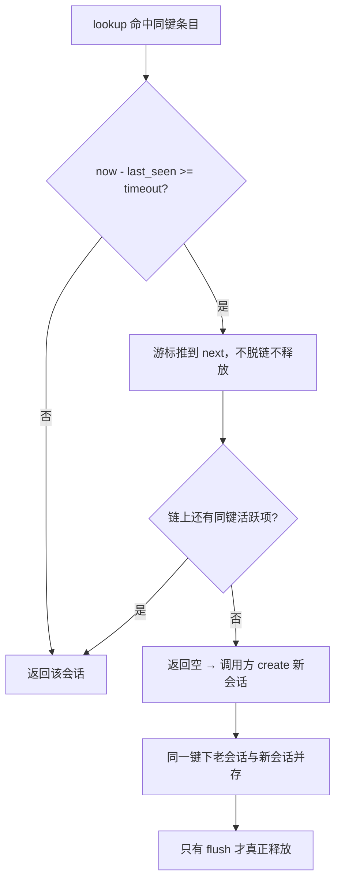

# 会话过期与回收：两种清扫、回调与扩展释放

“查询到过期条目”“被清扫”“被销毁”是三种不同状态，本项目对它们做了三套不同的事。本篇讲过期判定、两种清扫触发方式，以及扩展槽在释放时到底 frees 了什么；键构造与读写路径见姊妹篇。

## 适用版本与阅读目标

面向懂 C 和网络基础、初识本项目的学生，依据 DPDK 仓库 `20f882691ac03998e0e148e0a66041227cd3f751`（分支 master），状态：**待人工审核**。结论全部来自静态回读，未编译、未抓包、未运行清扫代码；逐条依据见[事实表](../evidence/session_expiry_and_release.md)。姊妹篇：[会话键与读写路径](session_key_and_lookup.md)。

## 核心对象和术语

会话条目由哈希桶链表串起，每个管理器带一个 `timeout`；条目上有三类可释放资源：单值扩展槽 `ext_data`、候选数组 `candidates`，以及三个具名指针 `tunnel_signal`/`geo_summary`/`tls_stream_buf`。过期回调是一个**进程级**函数指针，不属于任何单个管理器。判定与统计的写入位置见姊妹篇的 SL-001、SL-006。

来源：`session/session.h`、`session/session.c`；引用事实 SL-001。

## 过期：查到、跳过与真正清理

`session_lookup`（含 v6）命中已过期条目时只把游标推到 `entry->next` 继续找，**既不脱链也不释放**。过期判据是整秒的 `now - last_seen >= (time_t)mgr->timeout`，`now` 与 `last_seen` 都取 `time(NULL)`；`timeout` 是管理器创建时传入的**单一全局值**，本版本没有按 TCP/UDP 或按协议区分超时的实现（`session/README.md` 的“TCP 300 秒 / UDP 60 秒”是建议，不是代码）。

由此得到一条硬结论：**查到过期条目不等于它被清理**。返回空之后 `main.c` 立刻 create，于是同一键下同时挂着“已过期但还留着的老会话”和“刚建的新会话”，直到下一次清扫；老会话上的扩展数据不会转移过来，插件看到的是状态归零。真正清理只有两个入口：全量 `session_flush_expired` 与游标限额 `session_flush_expired_amortized`；本版本头文件里**没有**按键删除单个会话的接口。

来源：`session/session.c`、`session/session.h`；事实 SF-001、SF-002、SF-003。

## 单线程清扫与 worker 分摊清扫

单线程把清扫写在回调尾部：`now - g_last_session_flush >= 30` 才调全量清扫，一次扫完整张表；这个 `now` 在回调开头采集，与统计、每小时刷盘共用同一时刻，解析失败提前返回时那一轮被整体跳过。`capture_loop` 结束后 `main.c` 还会再补一次全量清扫。

worker 走另一套：游标 `flush_cursor` 是 worker 函数的**局部变量**，每轮 poll 结束（包括没收到包直接跳转的那一轮）都调用分摊版——单轮最多扫 `SWEEP_BUCKET_SCAN_CAP` 个桶，每释放一条会话检查一次是否超出 `SWEEP_TIME_BUDGET_US`，超时则游标停在当前桶、下次续扫。两个上限在 `main.c` 顶部定义为 2048 桶与 250 微秒。

两种清扫对**每条**过期会话做的事与顺序完全一样：先调用已注册的过期回调（此时会话内容仍完整），再 `session_free_candidates`，然后依次释放 `ext_data`、`tunnel_signal`、`geo_summary`、`tls_stream_buf`，最后 free 条目并递减计数；差别只在“什么时候扫、扫多少”。注释里关于时间预算收益的说明属设计意图，本篇未测量，不作性能或完整清扫时限保证。

来源：`main.c` 的回调尾部与 worker 循环、`session/session.c`；事实 SF-004、SF-005、SF-006。

## 扩展槽、所有权与释放范围

单值槽由 `session_set_ext_data` **无条件接管**：旧指针与新指针不同时，先把候选数组里指向旧对象的项清空，再 `free` 旧对象，然后写入新的 `ext_type/ext_data` 并置 `ext_locked`。它自己**不检查** `ext_locked`；会因锁定而拒绝的是 `session_confirm_candidate`。结论是“谁后写谁占槽，前一个对象当场被释放”，仍持有旧指针的代码此后读到的是悬空地址。

候选槽在固定的 `SESSION_MAX_CANDIDATES`（值为 4）数组里按类型查找，装满时 ensure 返回空、set 返回负值；覆盖写入同样先释放旧数据。释放时 `session_free_candidates` **跳过** `data` 恰好等于 `ext_data` 的那一项，因为紧接着 `ext_data` 会被单独释放——这是防二次释放的保护，不是漏写。另有一个不参与扩展仲裁的 `tls_stream_buf`：由 `main.c` 直接赋值、不经过任何 setter，但释放点仍在会话模块的过期与销毁两处。

来源：`session/session.c`、`session/session.h`、`main.c`；事实 SF-007、SF-008、SF-009。

## 线程与关闭边界

`session.c` 里没有任何锁或原子操作。无锁前提写在分摊清扫函数上方的注释里：会话表 per-worker、由本 worker 线程独占。这是**项目约定而非实现保证**——同一个管理器被两个线程并发 lookup/create 会破坏桶链表。反过来也不能因为存在哈希表、或因为 worker 各有独立实例，就宣布“会话层线程安全”：过期回调是进程级单个函数指针，被所有管理器共用，注册与注销函数本身也不加锁。

时间基准要分开：worker 自算的 `now` 取自 `CLOCK_MONOTONIC` 并被写进报文时间戳，而会话时间与全部过期判断都用 `time(NULL)`；同名字段不在同一时钟域。

销毁不等于自然过期：`session_manager_destroy` 释放同一组指针但**不调用**过期回调。关闭路径因此有实质差别——流水线模式等 worker 退出后直接对各会话表调 destroy，中间没有最终清扫，表内存活的会话**不会**进入画像/裁决补记；单线程先做一次全量清扫（这一步会跑回调）再销毁。

来源：`session/session.c`、`main.c`；事实 SF-010、SF-011、SF-012、SF-013。

## 边界、异常与常见误解

三处最容易越界：把“会话表 per-worker 独占”读成“会话层线程安全”（只成立到约定层面，见 SF-010）；把“会话被释放”读成“一定会被补记一次画像”（销毁路径不跑回调，见 SF-012）；把清扫参数读成性能保证（2048 桶与 250 微秒是可调常量，效果未测，见 SF-005）。本批未验证：清扫预算实际效果、真实流量下的桶长分布、超时值与内存占用的关系、并发热加载下的会话层表现。

来源：事实 SF-005、SF-010、SF-012。

## 阅读顺序与自查问题

建议顺序：`session.c` 的 `session_lookup` 过期分支 → 两个 flush 函数 → `session_set_ext_data`/`session_free_candidates` → `main.c` 的回调尾部、worker 循环与关闭流程。

自查：为什么同一条流在表里出现两次？（SF-001 + SF-003）为什么某个插件第二次拿不到自己上轮写的扩展？（SF-001 的新老切换，或 SF-007 的槽位被接管）为什么退出时画像少了最后一段流？（SF-012）这些是读码练习，不构成独立验收。

来源：事实 SF-001、SF-003、SF-007、SF-012。
