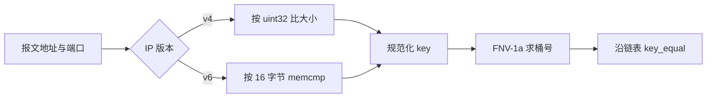

# 会话键与读写路径：一条流怎样被登记和计数

报文、会话和插件上下文是三样东西；一条流被登记成会话时，键做了归一化而方向没有。本篇只讲“怎么找到或建出一条会话、它记了什么数”，过期回收与扩展释放见姊妹篇。

## 适用版本与阅读目标

面向懂 C 和网络基础、初识本项目的学生，依据 DPDK 仓库 `20f882691ac03998e0e148e0a66041227cd3f751`（分支 master），状态：**待人工审核**。结论全部来自静态回读，未编译、未抓包、未运行；逐条依据见[事实表](../evidence/session_key_and_lookup.md)。范围止于会话键构造与报文路径上的 lookup/create/update。

读完应能回答：报文、会话、插件上下文分别是谁的对象；键怎么构造、IPv4 与 IPv6 差在哪；双向计数以谁为参照；会话字节数统计的是什么。姊妹篇：[会话过期与回收](session_expiry_and_release.md)。

## 核心对象和术语

所有者各不相同。`parsed_packet_t` 是本次报文的解析结果，单线程回调里是**栈上局部变量**，回调返回即失效；`session_entry_t` 由会话管理器 malloc 并挂在哈希桶链表上，寿命跨报文；`engine_ctx_t` 内嵌在 `engine_entry_t` 里，属于某个注册中心实例。三者通过指针相连，但谁都不因为收到指针就获得对方的所有权。

会话条目里还有两组地址字段：`key` 是**规范化**五元组，只用于定位；随后的 `src_ip/dst_ip`（或 `src_ip6/dst_ip6`）与端口保存**创建该会话的那个报文的原始方向**，计数和展示都用这一组。

来源：`main.c`、`session/session.h`、`plugin/engine.h`；事实 SL-001。

## 会话键与双向归一

IPv4 把两个 `uint32_t` 直接比大小，IPv6 用 `memcmp` 的字节序；两者都是地址相同才比端口，都把较小一端放进 `ip_low`。键相等判断先比 `ip_version`，再比端口与协议，最后比地址，所以 IPv4 会话和 IPv6 会话永不互相命中。

**归一化只保证双向报文映射到同一个键，不保证方向符合直觉。** `packets_ab` 的参照物是创建会话的那个报文：谁先被看到，谁就是 A。从流中间开始抓包（先看到服务器回包），A 就是服务器，`ab/ba` 与实际客户端方向相反。键本身不记录“谁是客户端”，插件要表达角色必须自己再判断（例如 [DNS 的会话端口定角色](dns_detection_and_parsing.md)）。

来源：`session/session.c` 的 `normalize_key_v4`、`normalize_key_v6`、`key_equal`；事实 SL-002、SL-003。

## 查询、创建与更新的实际调用

`main.c` 只在 `parsed.protocol` 为 6 或 17 时进入会话段，顺序固定为 lookup → 拿到空才 create → create 成功才 update；非 TCP/UDP 的报文根本不建会话。IPv6 与 IPv4 各有一套 `session_lookup*/session_create*/session_update*`，是**并行实现的三份函数**，地址比较与哈希混合方式不同，不因接口形状相同就当作同一实现的别名。

`session_create` 不查重、不检查会话数上限：直接 malloc、填键、头插进桶并把 `session_count` 加一。`session_update` 只做两件事：重取当前时间写 `last_seen`，再按源地址是否等于会话的 `src_ip` 给 ab 或 ba 累加。也就是说“建表”这件事没有任何防线，去重完全依赖调用方先 lookup。

来源：`main.c` 的会话段、`session/session.c`；事实 SL-004、SL-005。

## 计数与字段口径

`session_update` 的字节数形参名叫 `pkt_len`，但 `main.c` 两条路径传进去的实参都是 `caplen`——整帧捕获长度，含以太网/IP/传输头；捕获被截断时它是截断后的长度。会话侧也没有“总包数”字段，只有 ab/ba 两组包数与字节数，总量要自己相加。

因此：把会话字节数当成应用层字节数是常见误读；把 `bytes_ab` 当成“客户端上行流量”也不成立，它只是“A→B”，而 A 是第一个被看到的报文源端。要算负载字节，应看插件自己从 `payload_len` 得到的数值，而不是会话计数。

来源：`session/session.c` 的 `session_update`、`main.c` 两处调用实参；事实 SL-006。

## 边界、异常与常见误解

接口防御并不一致：`session_lookup` 与 `session_create` **不校验**传入的 manager 是否为空，而 `session_manager_destroy`、两个 flush 函数与 `session_get_count` 都先判空。此外 `session.c` 里定义了一个静态地址比较辅助函数 `ip_addr_cmp`，本文件**没有任何调用点**——键归一化用的是各自内联的比较，不要拿这个函数当实现依据。

三条常见误解：一，以为规范化会顺带把方向摆正（见 SL-003）；二，以为会话层会替你去重或限容量（见 SL-005）；三，以为 `detected_protocol` 之类的应用层协议名来自插件识别，实际上它按 `key.protocol` 填 TCP/UDP（见首批 PF-007）。

来源：`session/session.c`；事实 SL-007。

## 阅读顺序与自查问题

建议顺序：`session.h` 的 `session_key` 与 `session_entry` → `session.c` 的 `normalize_key_*`、`key_equal` → `session_lookup`/`create`/`update` → `main.c` 的会话段。发现“同一条流出现多个会话”时，按三条互不相同的证据链定位：桶里已过期但未被清扫的老条目、短包让端口保持 0 从而多流共用同一个端口 0 的键（`parse_packet` 的端口赋值受长度门控，见首批 PF-005）、以及同一五元组的包被分到不同 worker 队列（RSS 实际分流本批未验证，只作待查方向）。

自查：为什么 `packets_ab` 和你预期的客户端方向相反？为什么端口会是 0？会话计数为什么能超过真实流数？这些是读码练习，不是独立验收题。

来源：事实 SL-008。
