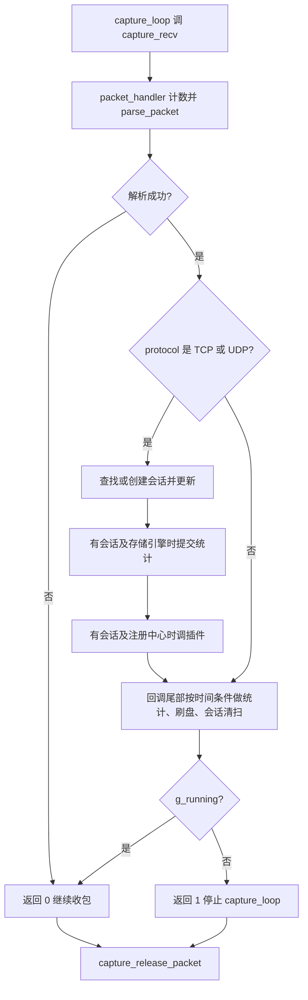

# 报文处理主流程：从抓包到会话、插件与统计

本项目有单线程回调和 DPDK worker 两条报文路径。理解处理流程，既要找出数据经过哪些模块，也要核对会话统计与插件调用的先后，以及谁释放原始缓冲区。本篇用主线与对照说明，避免把两条路径混成一条。

## 适用版本与阅读目标

本文面向懂 C 和网络基础、初识项目的学生，依据 DPDK 仓库 `20f882691ac03998e0e148e0a66041227cd3f751`，状态为**待人工审核**。以单线程回调路径讲清对象与调用顺序，再对照 DPDK worker 路径；未执行编译或抓包。

项目里“收到报文”“形成会话”“插件处理”“统计提交”是不同动作。正文不推断实际吞吐、网卡能力或数据最终落盘保证。逐项依据见[报文事实表](../evidence/packet_flow.md)。

## 从构建入口确认抓包实现

根 Makefile 将 `main.o` 与 `capture/libcapture.a` 等模块链接为 `traffic_monitor`。`capture/Makefile` 以自身目录的 `capture.c` 为基础，按构建选项加入 `capture_dpdk.c` 和 `capture_pcap.c`。所以本条构建链的 DPDK 后端是 `capture/capture_dpdk.c`，不是根目录同名副本；这不代表其他构建入口绝不会用后者。

运行时 `capture_create` 按配置取得后端操作表。AUTO 分支在编译支持范围内先检查 DPDK，再检查 PCAP；显式指定后端的分支不可用时返回失败，并非任意启动失败都会自动切换。是否能打开设备还要经过后端初始化与 open，不能把“选择了操作表”理解为硬件已经可用。

来源：两级 Makefile、`capture/capture.c`；事实 PF-001、PF-002。

## 单线程回调的实际顺序

`capture_loop` 单次收到包后调用 `packet_handler`，回调返回再 release。回调先增加全局包数与捕获字节数，再解析；解析失败返回 0，表示继续抓后续包。因此包数增长不能证明解析成功。图里的两级判定不要合并：只有解析失败才提前返回；解析成功但不是 TCP/UDP 时，跳过的只是会话与插件那一段，回调尾部的时间条件检查照常执行。

`capture_packet_t` 包含原始字节指针及 caplen；`parse_packet` 填写协议、端口等字段，并让 payload 指向原缓冲区内相应偏移。它没有复制一份完整负载，也不是完整协议合法性验证器；返回成功不能推导为任意报文都安全、完整且可识别。

来源：`main.c` 的 `parse_packet`/`packet_handler`、`capture_loop`；事实 PF-003、PF-004、PF-005。

## 会话、插件与统计如何连接

回调只对 TCP/UDP 进入 lookup/create/update，IPv4 与 IPv6 使用各自接口；创建失败或没有会话时，不会进入该路径的插件调用。IPv4 lookup 使用规范化键，跳过过期条目；update 刷新 last_seen 并累加方向统计。会话状态与本次 parsed_packet 不是同一个对象。

一个容易读错的顺序是：**单线程路径先将会话转为记录并提交统计，之后才调用 engine_process**。该 submit 函数更新内存虚拟集合，不能把提交成功等同于外部数据库落盘。`session_to_record` 在这里按传输层填写 TCP/UDP 名称，不足以证明所有插件识别结果已进入这份记录。

回调中的 engine_process 返回值没有被用于直接终止抓包；插件链内部停止与 capture_loop 停止是两层行为。插件接口的详细返回值见[插件生命周期](plugin_lifecycle.md)。

来源：`main.c` 的会话与插件段、`session/session.c`、`stats/storage_engine.c`；事实 PF-006、PF-007、PF-008。

## 周期工作与数据生命周期

单线程回调尾部按时间间隔提交系统/协议统计、检查每小时 flush 与每 30 秒会话清扫。这些检查依赖控制流到达相应代码；解析失败会提前返回，不能描述成一个始终独立运行的精确定时器。反之，非 TCP/UDP 的报文仍会走到这里。

过期清扫先调用已注册的过期回调，再释放会话。销毁会话管理器也会释放会话，但不能假定它执行完全相同的回调流程。

单线程释放接口先调用后端 release，再清空 capture_packet 的数据指针。DPDK release 释放 mbuf；PCAP release 不手动释放，数据由 libpcap 管理。局部的 parsed.payload 不会因 capture_packet 清零而自动清零，学生仍不能跨处理周期保存借用的原始地址。

来源：`main.c` 回调尾部、会话清扫/销毁、两个后端 release；事实 PF-009、PF-010、PF-011。

## DPDK worker 路径的区别

main 在 DPDK 后端分支启动 worker 与存储 lcore。worker 函数体直接轮询各自 NIC queue，解析后使用自己的会话表和引擎链；函数头“从 ring 取包”的注释已不能概括这一实现。

| 比较项 | 单线程回调 | DPDK worker |
| --- | --- | --- |
| 收包入口 | `capture_loop` / `capture_recv` | `capture_dpdk_recv_raw` |
| 会话、注册中心 | 全局实例 | 每 worker 独立实例 |
| 会话统计提交时机 | 插件调用之前 | 插件调用之后构造任务，存储 lcore 消费 |
| 原包释放 | 回调返回后经 release | worker 中 `rte_pktmbuf_free` |

worker 将会话转换为 storage_task 中的记录，随后释放原包；ring 满时回收任务，不保证每次统计任务都入队。无包时也会进入分摊式过期清扫。不能据此扩写为所有副作用都走同一个 ring、全系统无锁或同一吞吐保证。 还有一处容易踩的差别：两条路径的报文时间戳不在同一时钟域——worker 的 `timestamp_sec` 取自 `CLOCK_MONOTONIC`（usec 因 memset 为 0），单线程 DPDK 后端取 `time(NULL)`，PCAP 后端取 libpcap 包头时间戳；而会话的 `create_time/last_seen` 与过期判断始终用 `time(NULL)`。跨阶段做时间减法前先确认取的是哪一个。

来源：`main.c` 的启动、worker、storage 函数与两个后端的取时点；事实 PF-012、PF-013、PF-014、PF-015。

## 阅读顺序与自查问题

从 Makefile → main 分支 → capture_loop/worker → parse_packet → 会话 → 插件 → 统计 → release 逐段阅读。先确认自己研究的是哪条路径，再对照日志。

自查：计数为何可能包含解析失败的包？单线程统计记录为什么不一定含刚刚产生的插件信息？保存 payload 地址后为何不能在下一次回调随意读取？这些练习基于 PF-004、PF-007、PF-011，不是独立评测集。

本批没有验证复杂报文、RSS 实际分流、多段 mbuf、并发共享状态或落盘可靠性。要回答这些问题，需要另行设计测试，不能从现有流程图推导结论。
